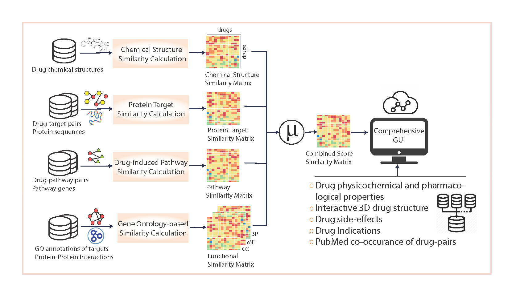
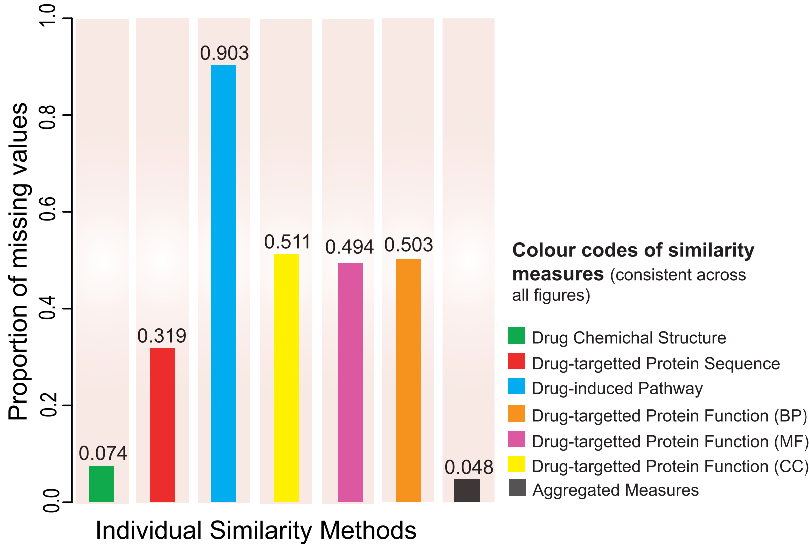
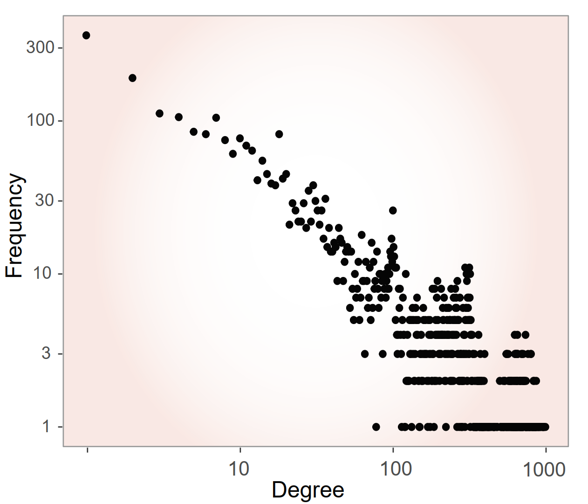
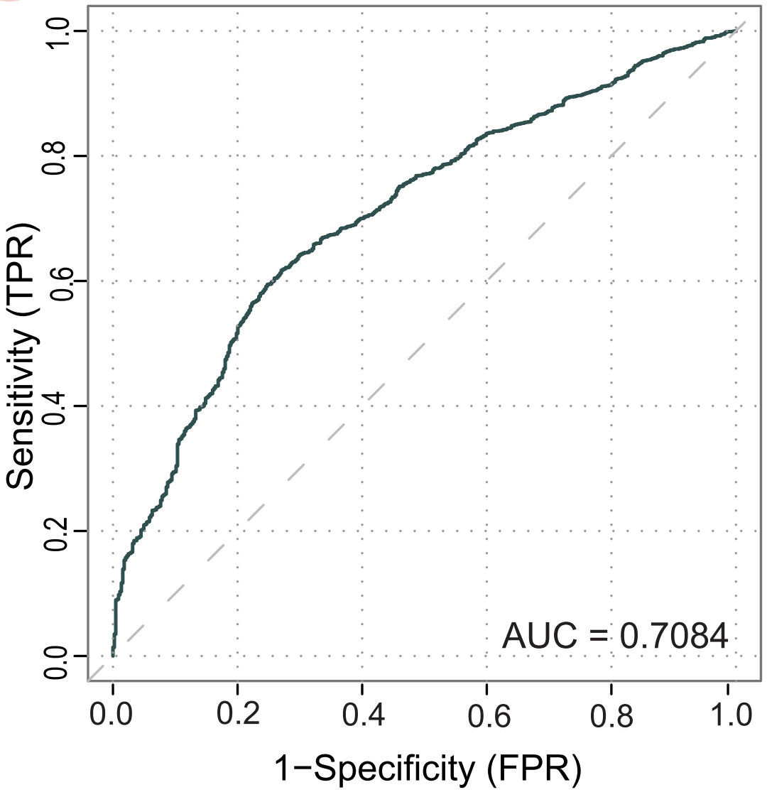
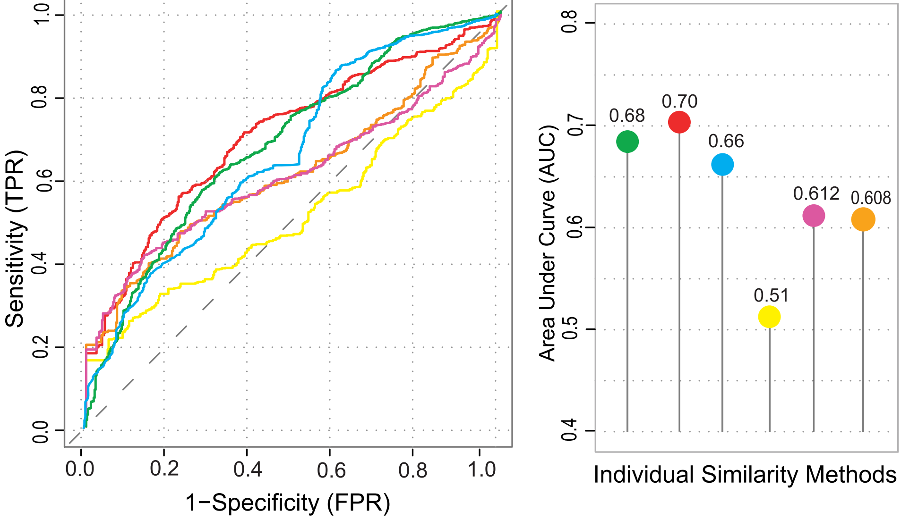
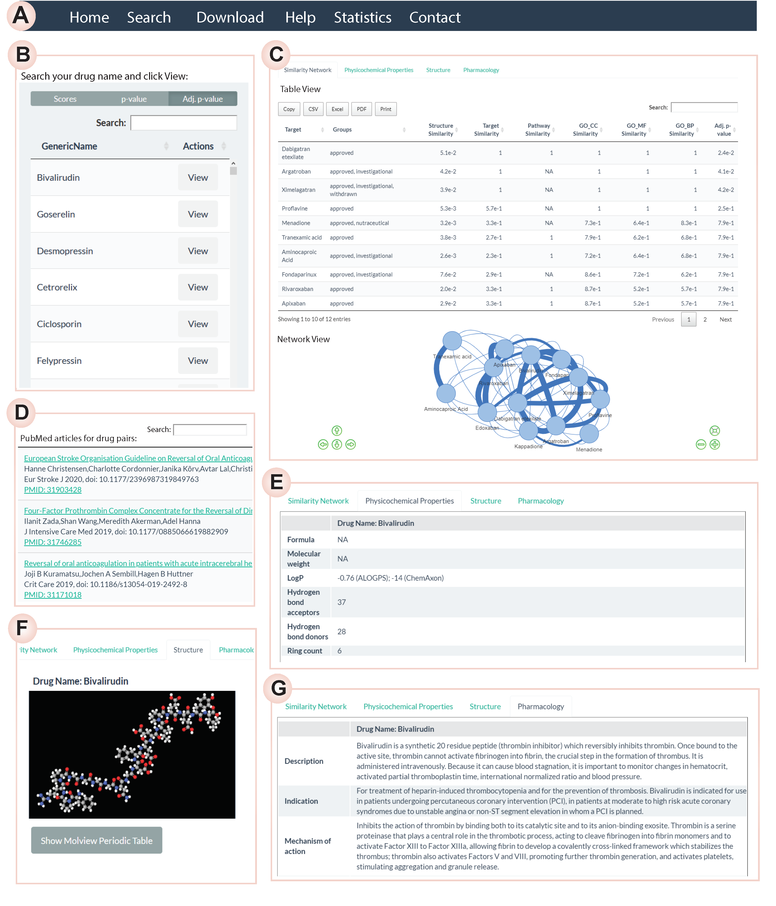
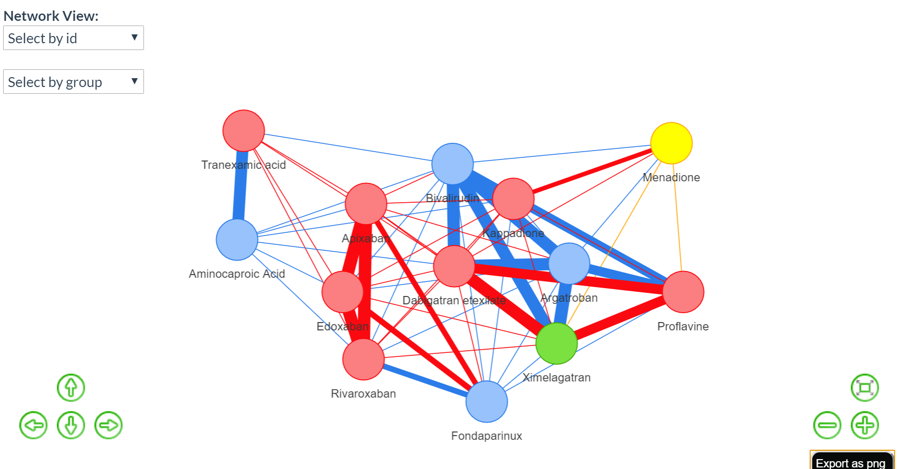
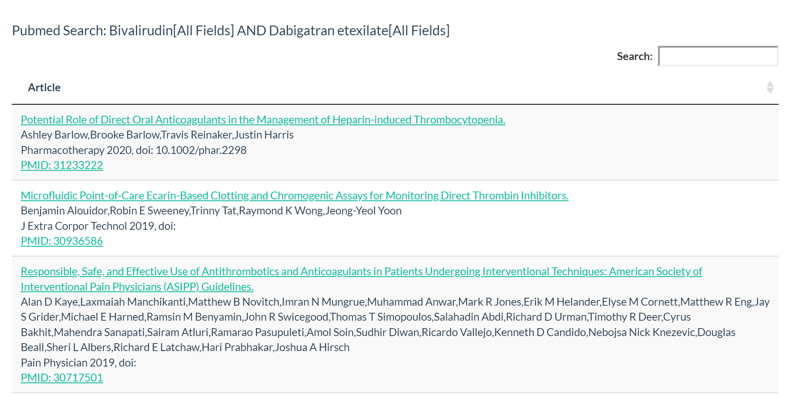
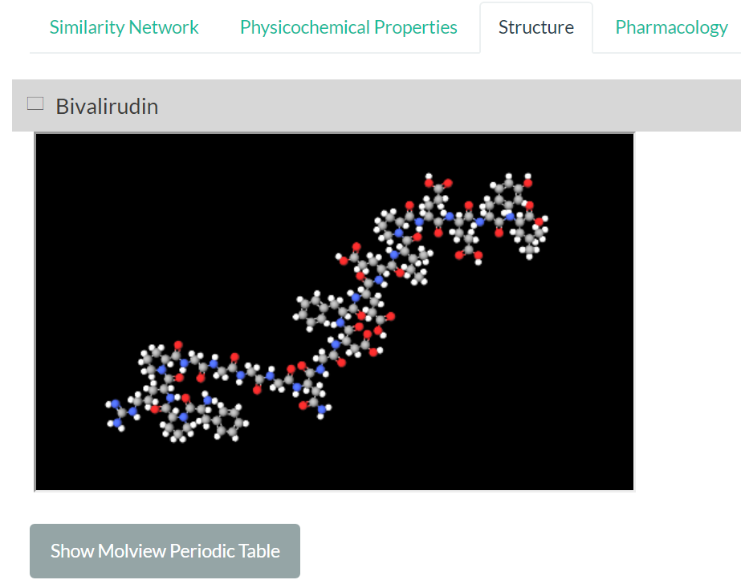

Bringing a new drug to market takes over a decade and enormous investment. **Drug repositioning**, finding new
uses for existing drugs, shortcuts much of that because safety profiles are already known. Its guiding hypothesis is
simple: **similar drugs should display similar therapeutic actions**. The hard part is measuring "similar". Existing
resources either covered few drugs or relied on a **single source of evidence**, such as chemical structure alone.
DrugSimDB, published in *Briefings in Bioinformatics*, closes that gap.

<!--more-->

## What is in the database

  
<b>10,367</b>small-molecule drugs

  
<b>238,635</b>drug pairs with significant aggregated similarity

  
<b>4</b>evidence modalities integrated

For every pair of drugs we compute similarity across complementary modalities:

- **Chemical structure**: molecular fingerprints and Tanimoto similarity;
- **Target protein sequence**: how similar the drugs' protein targets are;
- **Target function**: Gene Ontology and protein–protein-interaction context of the targets;
- **Pathways**: shared KEGG pathways and their constituent genes.

The modalities are then **aggregated** into a single, multi-evidence similarity score, and significant pairs form
the DrugSimDB network.

<figure>
  
  <figcaption>Multi-layer integration of drug similarity measures into a unified resource.</figcaption>
</figure>

## How it was built

1. **Data collection** from DrugBank, KEGG, I2D (protein interactions) and Enrichr libraries, with RepoDB and SIDER
   for validation and side-effect context.
2. **Computation** of each similarity modality in R, parallelised for scale.
3. **Integration** of the similarity matrices into one multi-modal network.
4. **Access** through an interactive web interface and bulk downloads.

The compilation code is documented and semi-automated, so the database can be **rebuilt at any time** as new drugs
and annotations appear, and further evidence types can be added to the integration.

## Why integration helps

- **Less sparsity.** Many drugs lack one data type, for example an unknown target. Integration fills those gaps.
  
- **Network structure.** The integrated similarity network is **scale-free**, like many biological networks:
  a few hub drugs connect large neighbourhoods, which suits diffusion-based repositioning algorithms.
  
- **Better repositioning performance.** Multi-modal scores outperform the individual similarity measures when
  benchmarked against known repositioning cases from RepoDB.
  
  

## The web explorer

<figure>
  
  <figcaption>The R Shiny interface for searching, filtering and exporting drug similarities.</figcaption>
</figure>

With the interactive app you can:

- search a drug and inspect its side effects (from SIDER);
- explore its **similarity network**, or switch to a table view;
  
- hover over a node for drug information, or click an edge to retrieve **PubMed evidence** for that drug pair;
  
- view **3D chemical structures** and browse physicochemical and pharmacological properties.
  

## Use cases

- **Drug repositioning:** rank candidates by similarity to drugs with a known indication.
- **Side-effect and drug–drug-interaction hypotheses:** similar drugs often share adverse-event profiles.
- **Network medicine:** run community detection, random walks or graph neural networks on the similarity network.
  DrugSimDB's multi-evidence similarity also powers our [COVID-CDR](/blog/2021/covid-cdr-combination-therapy/)
  platform and the proposed **Onco-CDR** platform for cancer combination therapy.

## Access

- Web app: [unsw-data-analytics.shinyapps.io/DrugRepo](https://unsw-data-analytics.shinyapps.io/DrugRepo/)
- Full database download: [figshare](https://figshare.com/articles/dataset/DrugSimDB/11948904)
- Code: [github.com/Akmazad/DrugSimDB](https://github.com/Akmazad/DrugSimDB)
